# Classic macOS Dashboard Revival

## 让 Mac OS X Tiger – macOS Mojave (10.4–10.14) 的 Dashboard 联网小组件重新工作。

> Apple 从 macOS Catalina 开始移除了 Dashboard 功能，其内置工具的联网服务有很多已经失效，而重复联网可能会导致 Dashboard 崩溃退出，本项目修复了 Mac OS X Tiger-macOS Mojave 的 Dashboard 中自带的四款联网插件，分别为天气、股票、翻译、汇率 (单位转换)，具体教程如下。

> 原则：不修改任何自带插件，恢复原生效果。

> 原理：macOS 的 Dashboard 中的工具是明文存储在系统中的。换句话说，仪表盘中的工具，其请求和响应是已知的。笔者自己写了一个 python 脚本做了同样返回，接口替换为可用接口并把 python 脚本做成了 docker 镜像。只需要在局域网中部署 docker 容器并在局域网的 dnsmasq 或 smartdns 中将原域名重定向为局域网中启动 docker 容器的机器 ip 即可。

## 部署教程

### 注册百度翻译开放平台
> 天气、股票、翻译、汇率这四个联网服务，其中的翻译笔者选用的百度通用翻译。在如下网址注册使用。其月免费额度足够个人使用。https://fanyi-api.baidu.com/product/112， 注册完成在控制台查看并记录 APP ID 以及 Key。

### 获取镜像

#### X86 机型
```
docker pull bugprogrammer/dashboard_fix:latest 
```

#### ARM 机型
```
docker pull bugprogrammer/dashboard_fix:latest_arm64 
```

### 准备 docker-compose.yml 文件 (宿主机端口必须为 80)

> 文件已在仓库中提供，根据机器架构 (X86/ARM) 复制到仓库根目录并重命名为 docker-compose.yml 即可

#### X86 机型
```
services:
  dashboard-mock:
    image: bugprogrammer/dashboard_fix:latest
    container_name: dashboard_fix
    restart: unless-stopped
    ports:
      - "80:80"
    environment:
      - BAIDU_APPID=${BAIDU_APPID:-}
      - BAIDU_KEY=${BAIDU_KEY:-}
```

#### ARM 机型
```
services:
  dashboard-mock:
    image: bugprogrammer/dashboard_fix:latest_arm64
    container_name: dashboard_fix
    restart: unless-stopped
    ports:
      - "80:80"
    environment:
      - BAIDU_APPID=${BAIDU_APPID:-}
      - BAIDU_KEY=${BAIDU_KEY:-}
```

### 在 docker-compose.yml 文件同目录创建 .env 文件，填写百度翻译开放平台的APP ID 以及 Key
```
BAIDU_APPID=xxxx
BAIDU_KEY=xxxx
```

### 启动 Docker 容器

#### Compose v1
```
docker-compose up -d
```

#### Compose v2
```
docker compose up -d
```

### DNS 重定向 (三种方案任选，假设部署 Docker 容器的物理机 IP 为 192.168.0.19)

#### hosts (单系统首选)

```
192.168.0.19 wu.apple.com
192.168.0.19 iphone-wu.apple.com
192.168.0.19 wu-quotes.apple.com
192.168.0.19 wu-stocks.apple.com
192.168.0.19 wu-charts.apple.com
192.168.0.19 wu-converter.apple.com
```

#### dnsmasq.conf
```
address=/wu.apple.com/192.168.0.19
address=/iphone-wu.apple.com/192.168.0.19
address=/wu-quotes.apple.com/192.168.0.19
address=/wu-stocks.apple.com/192.168.0.19
address=/wu-charts.apple.com/192.168.0.19
address=/wu-converter.apple.com/192.168.0.19
```

#### smartdns
> 路径如下: /etc/smartdns/custom.conf
```
address /wu.apple.com/192.168.0.19
address /iphone-wu.apple.com/192.168.0.19
address /wu-quotes.apple.com/192.168.0.19
address /wu-stocks.apple.com/192.168.0.19
address /wu-charts.apple.com/192.168.0.19
address /wu-converter.apple.com/192.168.0.19
```

## 测试

### 执行仓库中的 test\_dashboard.sh 脚本 (假设部署 Docker 容器的物理机 IP 为 192.168.0.19)

```
./test_dashboard.sh 192.168.0.19
```

### 成功结果如下
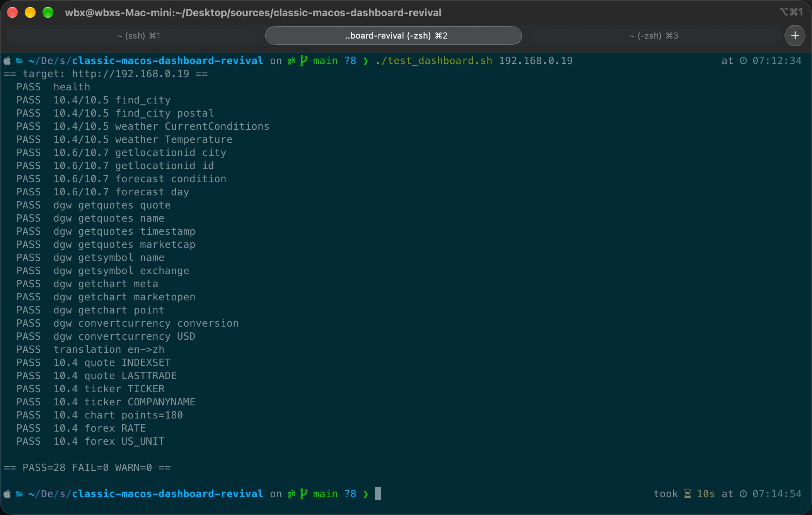

## 展示图
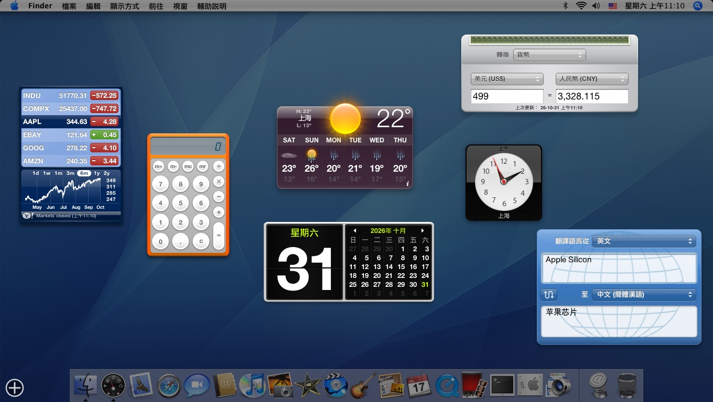
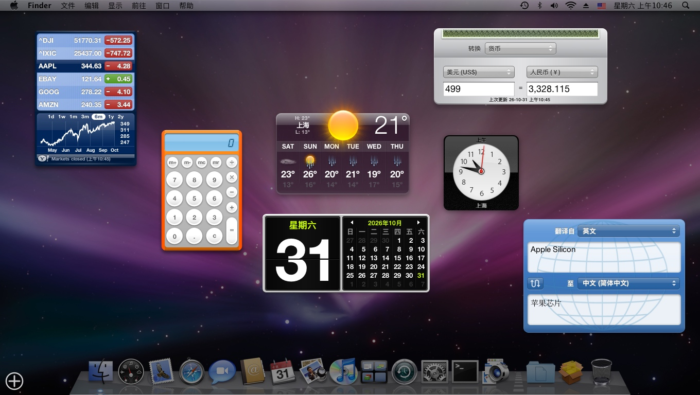
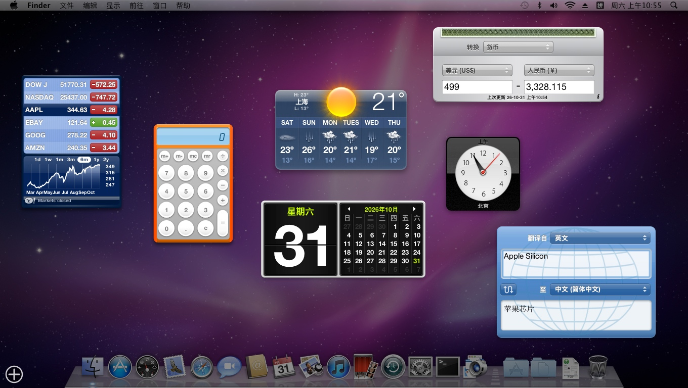
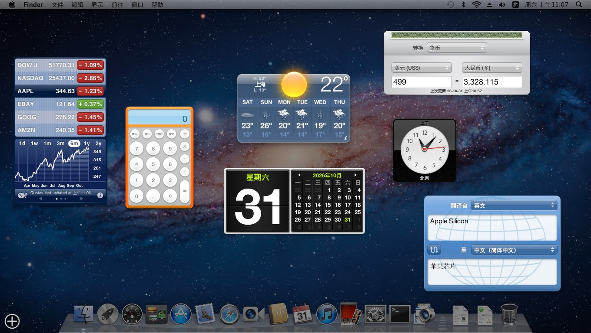
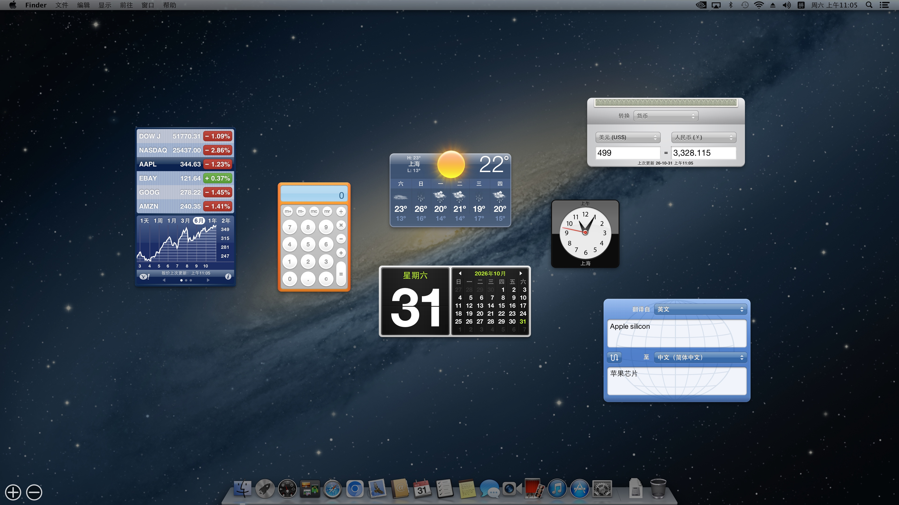
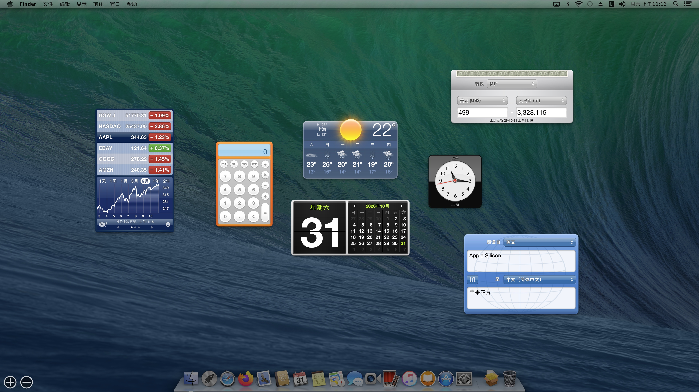
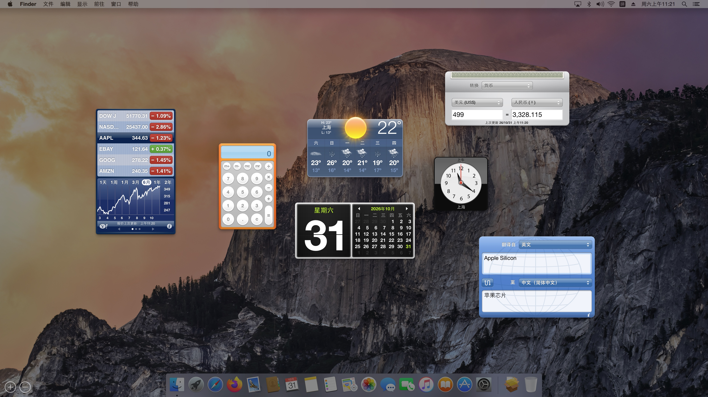
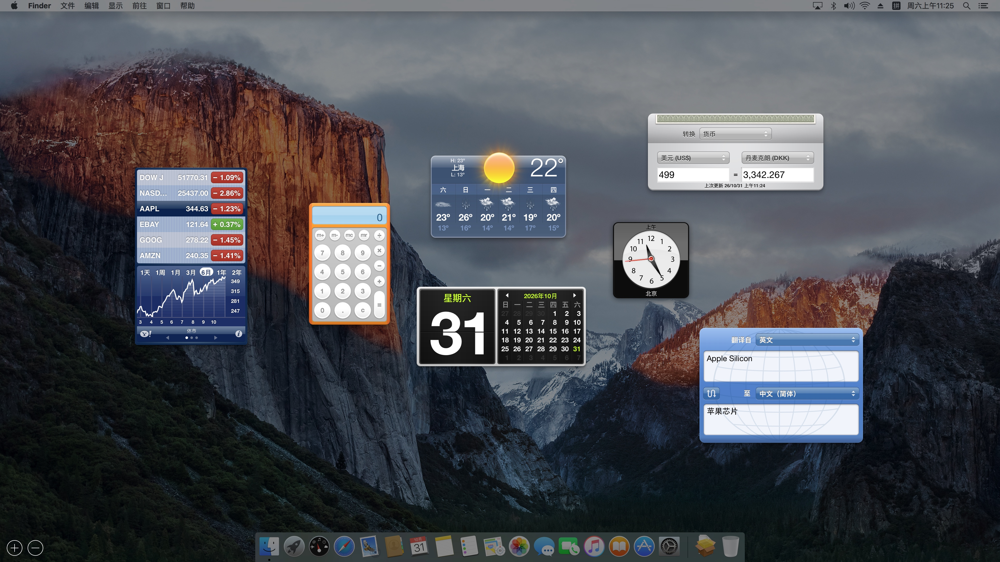
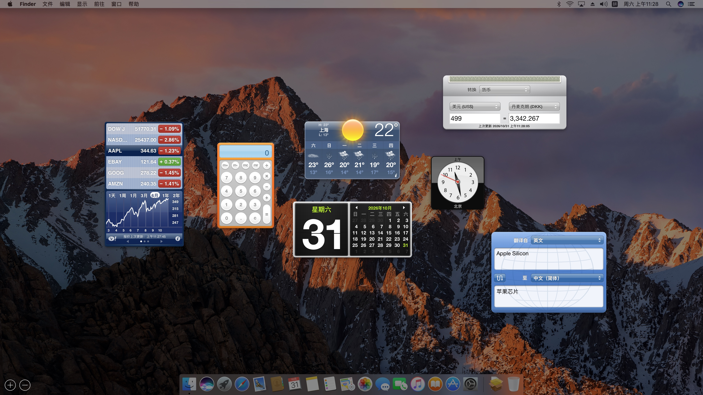
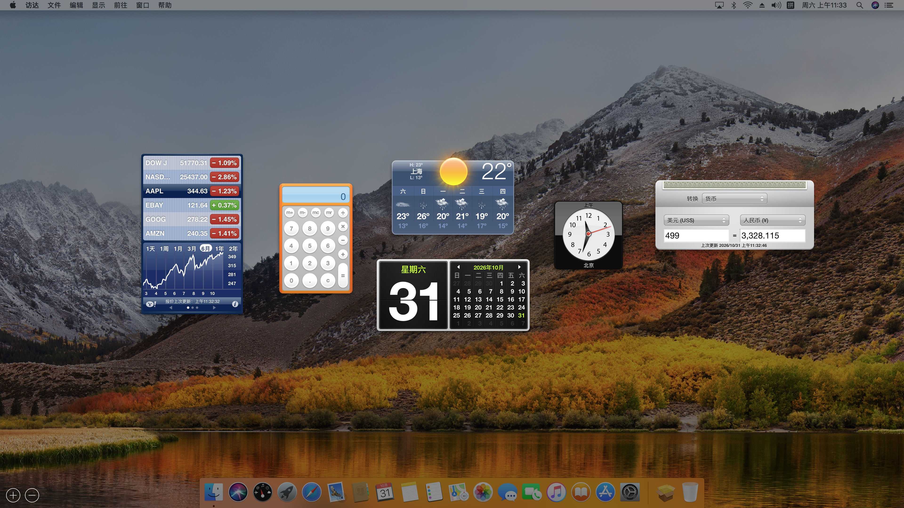
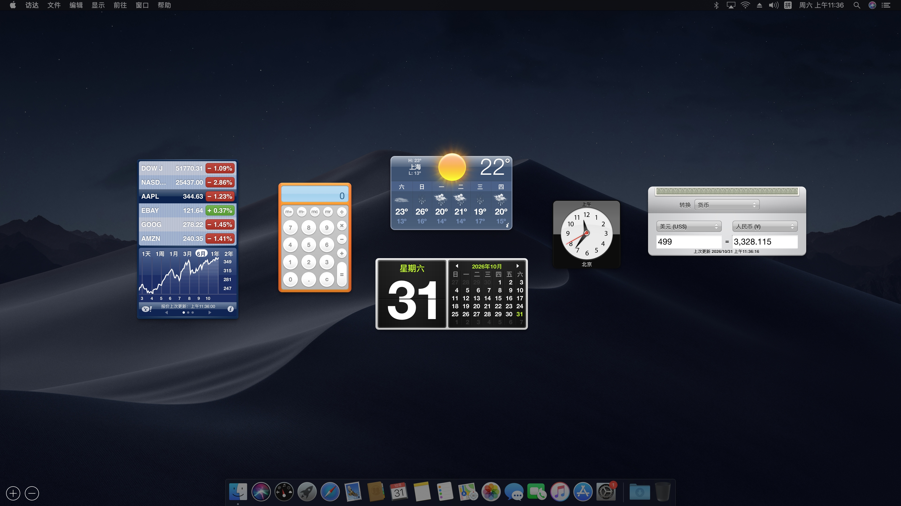

## License
### MIT